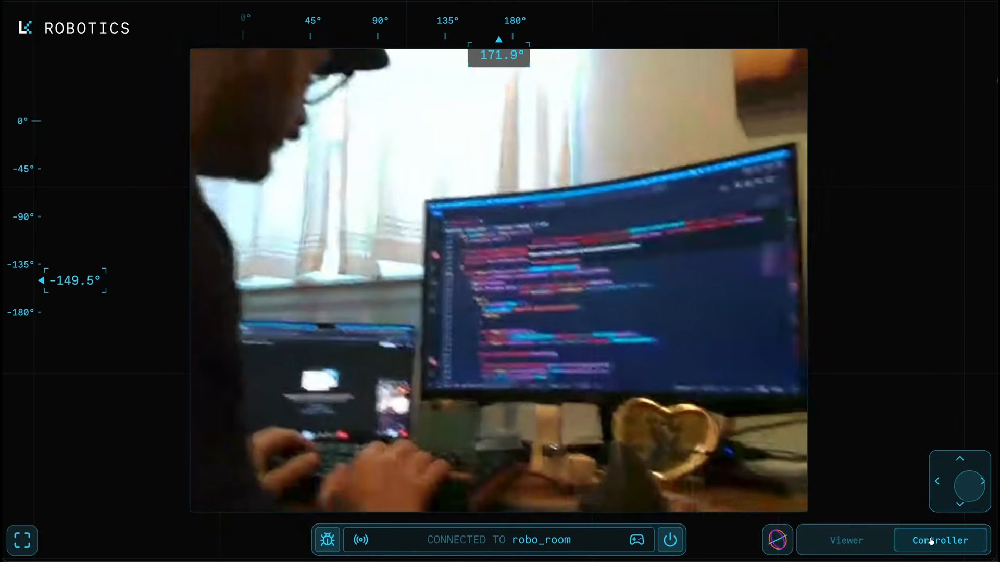

# LiveKit Teleop

An example demonstrating real-time robot teleoperation over [LiveKit](https://livekit.io). A camera-equipped pan/tilt robot, [cobra_flex_ros](https://github.com/livekit-examples/cobra_flex_ros),
publishes video, batter state, heading, and pan/tilt servo state as LiveKit tracks. Multiple users can access the web UI to view the live feeds, and a single operator can acquire control.

## Components

### Edge / Robot (C++) — [`cobra_flex_ros`](https://github.com/livekit-examples/cobra_flex_ros)

A C++ application built with the [LiveKit C++ SDK](https://github.com/livekit/rust-sdks) that runs on the robot (e.g. Jetson) and bridges the hardware to a LiveKit room.

- **[Cobra Flex ROS](https://github.com/livekit-examples/cobra_flex_ros)** — A [Waveshare Cobra Flex robot](https://www.waveshare.com/wiki/Cobra_Flex?srsltid=AYCX9vIOoVhcirrU0qNPDAn9p2GC-BSLtka3lnPunrbLwDO1QzNUXXdU) with a
pan tilt assembly mounted on top. The hardware is driven by ROS2. Publishes all sensor and actuator state as LiveKit data and video tracks and accepts velocity commands gated by an `acquire_control` RPC.

### Web UI (Next.js) — [`web/`](web/README.md)

A browser-based teleoperation interface built with Next.js, React, and the [LiveKit JS SDK](https://github.com/livekit/client-sdk-js). Provides a full-screen video viewport with
on-screen joystick and keyboard controls for pan/tilt movement, live degree scales, and operator-mode locking.
