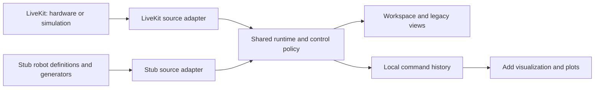

# Plan: replaceable robot sources and stubbed development

Status: proposed implementation plan. No application changes are included.

## Outcome

From `web/`, start the normal GUI with:

```sh
pnpm run dev --stubbed-data
```

Opening `/` takes the developer to an already-connected workspace with a rover,
changing telemetry, and exactly one clock video generated by GStreamer. No
LiveKit server, credentials, robot, physics simulator, or simulation supervisor
is needed. Controls use the existing request-control and arm flows. Their outputs
are captured locally and available through **Add visualization → Control commands**.
They do not change telemetry or move a simulated robot.

Additional configurations use the same runtime:

```sh
pnpm run dev --stubbed-data --robot=arm
pnpm run dev --stubbed-data --robot=dual-arm-mobile
pnpm run dev --stubbed-data --stub-video=canvas
pnpm run dev --port 3001
```

`rover` and `gstreamer` are the stub defaults. Canvas is an explicit lightweight
alternative for development and browser tests; it does not replace the requested
GStreamer default silently. Normal development continues to use LiveKit for both
real hardware and existing managed simulations.

## Existing foundation and gaps

The current working tree already contains much of the necessary structure:

| Existing code | Reuse or change |
| --- | --- |
| `src/lib/teleop/types.ts` | Reuse `Transport`, publications, sources, operations, and media kinds as the starting boundary. |
| `runtime.ts`, `streams.ts`, `cameras.ts`, `controls.ts` | Preserve runtime ownership, shared readers, bounded plotting, lifecycle gates, and control adapters. |
| `livekit-transport.ts` | Keep SDK access inside the LiveKit adapter. |
| `fixture-transport.ts` | Reuse deterministic injection, generated media, and local command capture; extract reusable pieces. |
| `/workspace?fixture=1` | Preserve this test/lab entry point and its fault-injection behavior. |
| `workspace-app.tsx`, `lib/demo/use-session.ts` | Replace direct adapter construction and static SDK imports with a source factory. |
| `add-visualization.tsx` | Extend the existing field picker and plots with local command sources. |
| Legacy `/rover`, `/robot`, rover hooks, status and video components | Migrate their direct LiveKit access behind the same boundary. |

The current fixture is one hardcoded rover with two arms and several cameras.
Its command array has no timestamps, is unbounded, and is not a plot source.
The runtime still understands Portal attributes/RPC names and chooses adapters
using `transport.fixture`. `predev` unconditionally builds the vendored SDK.
The managed simulation hook also imports LiveKit directly. Changing only the
connection screen would leave these dependencies in place.

## 1. Finish the source boundary

Evolve the existing `Transport` into an application-facing `RobotSource` rather
than introducing a second competing runtime. The boundary exposes:

- Connection lifecycle and connection/robot/catalog/ownership change events.
- Robot summaries with stable identity, label, compatibility, and capabilities.
- `describeRobot(robotId)` returning normalized control/media metadata.
- Data publication discovery and abortable frame reading.
- Media subscription and attachment to ordinary HTML media elements.
- Request/release ownership and robot-scoped command writers.
- Explicit service/action invocation for discrete operations, with advertised
  input/output schemas and command observation just like streaming commands.
- Idempotent shutdown that cancels readers, writers, listeners, and media handles.

Keep raw `Room`, participants, SDK tracks, Portal attribute keys, discovery RPC
names, and lease protocols inside adapters. The LiveKit adapter translates Portal
v3 discovery and ownership into these methods. The stub adapter implements them
locally without pretending that it has joined a room. Keep the existing wire
discovery document distinct from its normalized application representation.

Inject a session policy and control-adapter registry when creating the runtime.
Source kind alone never grants a control profile permission to execute: stub
limits, managed-simulation policies, and verified hardware policies remain
separate. Unknown profiles remain visible with an unsupported reason.

Create a single source/session factory used by workspace, legacy pages, and
managed sessions. Load LiveKit adapters only on live connection paths. Select
stub mode before mounting the simulation landing page or issuing its API calls.
An explicit stub session cannot fall through to live credentials or a `session`
query parameter; show an actionable mode conflict if both are requested.



Keep data and media extensible independently: a decoder registry handles frame
encodings, a media registry handles attachment implementations, and a control
registry handles profile encoding, units, limits, feedback, and release behavior.
Adding an unfamiliar encoding must produce an unsupported state until its decoder
is registered. A new JSON field needs no new React component.

## 2. Define robots through composition

Introduce a stub-only `RobotDefinition` containing stable robot identity, label,
components, generated publication definitions, control interfaces, and optional
starter panels. This is local authoring configuration, not a new requirement for
real robots to declare all their telemetry in `get_robot_config`.

Compose reusable component builders: differential base, IMU, battery, camera,
arm, and optional gripper/pan-tilt. Each instance has its own namespace, frame,
joints, units, limits, and rates. `left_arm` and `right_arm` are instances of the
same arm definition. Do not infer hardware semantics from robot names.

Ship three presets:

| Preset | Components |
| --- | --- |
| `rover` (default) | Differential base, IMU, battery, one front camera. |
| `arm` | One arm, joint/pose feedback, one camera. |
| `dual-arm-mobile` | Differential base, IMU, battery, two namespaced arms, one camera. |

Use the existing discovery examples in `generalization/examples/` as contract
references, adapting only the profiles each preset advertises. The default rover
must not advertise arm controls or unavailable devices. Validate duplicate topic
names, component IDs, joint bindings, units, and unsupported profile references
at startup. Permit multiple definitions in one stub session so robot selection
and isolation can be tested.

An additional sensor requires a definition and generator; another camera requires
a media definition; another robot composes components. A new control profile
adds its schema/encoder/release adapter and, only when needed, an input widget.

## 3. Generate realistic, reproducible telemetry

Separate `StubSource` from the fault-injection fixture and from telemetry
generators. Share their low-level queues/media helpers and keep existing fixture
tests working through a compatibility wrapper. Inject a monotonic clock and
seeded random source; use elapsed time rather than counting timer callbacks.

Initial rover publications:

| Topic | Fields / units | Nominal rate |
| --- | --- | --- |
| `/imu/data_raw` | Quaternion orientation; angular velocity x/y/z in rad/s; acceleration x/y/z in m/s² | 50 Hz |
| `/battery_state` | Voltage V, current A, percentage 0–1, temperature °C, present/status | 1 Hz |
| `/odom` | Pose, linear velocity in m/s, angular velocity in rad/s, frame IDs | 20 Hz |
| `/speed` | Scalar forward speed in m/s | 20 Hz |
| `/status` | Enabled flag and operating state | 2 Hz |
| `front` | One generated clock video, initially 960×540 | 20 fps |

Derive speed, odometry, and IMU yaw rate from the same analytic trajectory, with
normalized quaternions and plausible bounded values. Battery changes slowly.
All generators are independent of control input. Arm presets add exact named
joint position/velocity/effort and pose feedback with documented units.

Publish field schema, units, frame and nominal-rate metadata so fields can be
picked without opening a preview. Preserve exact topic names. Attach monotonic
receipt timestamps and optional source timestamps to frames; receipt time drives
freshness and plotting. Keep all subscriber queues bounded. Consumers should
share one generator/reader, and idle subscriptions should release their demand.

## 4. Provide the GStreamer clock video

Have the development launcher own one GStreamer process and one temporary output
directory. Use a test pattern plus visible clock, H.264 encoding, and HLS output.
Proposed pipeline, to be verified on the supported development platforms:

```text
videotestsrc is-live=true pattern=ball
  ! video/x-raw,width=960,height=540,framerate=20/1
  ! clockoverlay time-format="%H:%M:%S"
  ! videoconvert
  ! x264enc tune=zerolatency speed-preset=ultrafast key-int-max=20
  ! h264parse
  ! hlssink2 target-duration=1 playlist-length=3 max-files=6
      location=<temp>/segment%05d.ts playlist-location=<temp>/index.m3u8
```

Serve the playlist and segments through a development-only Next route rooted at
that exact directory, with correct content types and no-cache behavior. Restrict
paths to generated file names. HLS writes files; it does not provide an HTTP
server. Use native HLS where available and a lazily loaded HLS.js media adapter
elsewhere. Both this and LiveKit attach to the existing `<video>` views, preserving
camera selection, fullscreen, and decoded-frame monitoring.

This choice avoids a signaling service and LiveKit but adds roughly a few seconds
of video startup/latency. It is suitable for GUI development, not a test of real
teleoperation latency. Keep the media interface open to a later WebRTC adapter
if low-latency stub video becomes a requirement.

Check required elements with `gst-inspect-1.0` before launching. A missing element
must name the problem and explain the explicit canvas alternative. Wait for a
usable playlist/segment with a bounded timeout before reporting video ready.
Propagate process failure as camera unavailable. On Ctrl-C, launch failure, or
Next exit, stop the process and remove temporary files. Browser unmounts detach
players; the launcher-owned producer stays alive for other tabs until shutdown.

Sources: [test video](https://gstreamer.freedesktop.org/documentation/videotestsrc/index.html),
[clock overlay](https://gstreamer.freedesktop.org/documentation/pango/clockoverlay.html),
[HLS sink and file-serving requirement](https://gstreamer.freedesktop.org/documentation/hls/hlssink2.html).

## 5. Make outgoing commands ordinary visualization sources

Add a runtime-owned command observation layer shared by stub, simulation, and
hardware sessions. Instrument the command writer boundary once, including the
release/stop path. Observe the encoded value after profile validation, clamping,
and unit conversion; record failures separately. Stub writers accept and discard
outputs after observation, without feeding them into telemetry generators.

Each record contains robot identity, connection epoch, interface, operation,
destination, schema/profile, monotonic timestamp, sequence, payload, and local
result (`captured`, `accepted_by_writer`, or `rejected`). Include discrete service
and action requests in the same mechanism. Local success does not assert robot
receipt or execution: LiveKit data tracks are lossy and may drop frames.

Register local data sources for every advertised output before the first input.
Use a separate origin in source identity, e.g.:

```text
origin=command, robot=stub-rover, interface=base, operation=drive
  payload.linear.x     m/s
  payload.angular.z    rad/s
```

Keep origin in catalog keys, stream keys, selectors, persistence, and exclusion
handling so an inbound `/cmd_vel` publication cannot collide with the local
outgoing-command source. Robot telemetry exclusions apply to robot-origin
sources. Local commands never satisfy required robot-feedback bindings.

Extend **Add visualization** with a source selector for **Robot data** and
**Control commands**, then reuse the existing field picker, numeric plot/value,
joint selector, state timeline, and raw JSON renderer. Label idle outputs
**No commands yet** and inactive outputs **Last command at …**; a stopped input
is not an incoming telemetry outage. Do not manufacture repeated zero samples.

Maintain bounded history even before a plot is opened: initially 60 seconds and
5,000 records per command source, with a session-wide memory cap. Deep-copy
payloads so later mutation cannot change history. Seed a newly opened plot from
the history, then continue live without duplicate samples, preserving original
timestamps rather than assigning replay time. Plot accepted/captured values by
default; rejected attempts remain inspectable with their error. Capture neutral
release commands and distinguish them from synthetic display values.

Clear history on robot/connection epoch changes and reject late writer callbacks
from older epochs. Namespace layouts by source mode and robot identity. Bump the
layout format for explicit origins; migrate current v1 layouts to robot-origin
sources and preserve the original saved value until migration succeeds.

Source: [LiveKit data-track delivery and push behavior](https://docs.livekit.io/transport/data/data-tracks/).

## 6. Wire the development command and all GUI entry points

Replace `dev: next dev` with a small Node launcher that consumes `--stubbed-data`,
`--robot`, and `--stub-video`, tolerates an optional argument separator, and passes
ordinary Next flags through unchanged. Spawn children with argument arrays and
forward termination signals. Read the installed Next development documentation
before implementing this change, as required by `web/AGENTS.md`.

Move the unconditional `predev` SDK build into the launcher's live branch.
Preserve the production SDK build. Stub mode skips SDK building and needs no
LiveKit credentials or running services; normal dependency installation still
follows the repository's workspace/submodule requirements.

Lazy imports alone do not guarantee this: the vendored package exports generated
`dist/` files, and bundlers may resolve an unexecuted dynamic import. Select the
source factory through a mode-specific build alias/entry module so the stub
module graph never resolves live SDK adapters or LiveKit React providers. Verify
this in an isolated checkout with the SDK installed but its build output absent.
Wire every stub-accessible route to this boundary before promising an SDK-free
startup. Ordinary production builds continue to validate the live modules.

Pass a validated development configuration from the server to the selected
client entry point. Use a separate Next output directory for stub mode to avoid
reusing a live development bundle. Opening `/` in stub mode redirects to an
auto-connected `/workspace`; retain a visible **Stubbed data** mode indicator.
Disconnect closes the runtime and leaves an explicit stub reconnect action.

Migrate `/rover` and `/robot` providers, telemetry hooks, command hooks, status
bar, video dialog and media hooks to source-neutral contexts. Keep their views,
but remove their room/track/session dependencies. Encapsulate legacy binary
codecs, ROS topic aliases, service RPCs and lease behavior in legacy LiveKit
adapters, preserving their actual wire formats and units. Do not reinterpret
legacy rover gains as SI Twist semantics. The existing `/robot` is a pan/tilt
view; use a matching pan/tilt stub definition there, while `--robot=arm` selects
the articulated-arm workspace preset.

Keep managed simulation launch/deadline/credentials logic in a live-session
provider. It supplies the same runtime with its existing simulation policy.
This removes LiveKit from presentation code without replacing the working
simulation supervisor or changing robot gateway protocols.

## Implementation sequence

| Step | Deliverable | Completion check |
| --- | --- | --- |
| 1 | Normalize the existing transport and inject session policy; implement the LiveKit adapter and source factory. | Existing workspace discovery, isolation, control transition, and managed-session tests pass. |
| 2 | Extract stub components/generators; ship rover, arm, dual-arm-mobile and legacy pan/tilt definitions. | Deterministic telemetry and isolated robot selection work through one runtime. |
| 3 | Add command observation, bounded replay, explicit source origins and layout migration. | A plot added after control input shows correctly timed prior commands and release values. |
| 4 | Add launcher, root entry selection, GStreamer HLS and explicit canvas media backend. | The requested command opens the populated workspace with one clock video and no live services. |
| 5 | Migrate legacy GUI hooks/providers and managed-session construction to the factory. | `/workspace`, `/rover`, `/robot`, previews and managed controls use the shared boundary. |
| 6 | Complete regression checks and developer instructions. | Acceptance scenarios below pass and extension recipes are documented. |

Steps 1–4 deliver the first usable stub workspace. Step 5 is required to complete
the abstraction across `web/`; it must not be dropped as unrelated cleanup.

## Verification and acceptance

- Start with LiveKit/supervisor stopped and credentials absent. Run the exact
  stub command with no prebuilt vendored SDK; verify no SDK build and no token,
  simulation, signaling, or remote media requests.
- Verify advancing GStreamer clock pixels/decoded video frames in supported
  Chromium and Safari configurations. Check missing plugins, failed encoders,
  media startup timeout, process exit, and cleanup. Test canvas separately.
- In the default rover, add battery, speed and IMU plots through the regular GUI.
  Check values, units, rates and shared subscriptions without custom stub panels.
- Request control, arm keyboard/joystick input, issue commands, release input,
  then add plots for `payload.linear.x` and `payload.angular.z`. Verify prior
  commands, live updates and neutral release values. Telemetry remains generated
  independently. Exercise gamepad through deterministic input injection.
- Select arm and dual-arm-mobile presets; check exact joint names, feedback
  gating, independent left/right commands and absence of base controls on an
  arm-only robot. Add a sensor/camera definition without editing GUI components.
- Test local command/inbound topic collisions, rejected writes, discrete control
  requests, history bounds, replay timestamps, switching robots, reconnects,
  stale callbacks and React remounts. No source inherits another robot's data.
- Preserve layout save/import/export, migrate v1 layouts, and verify live/stub
  storage isolation. Confirm hidden panels release demand and all timers,
  readers, players and processes shut down under their respective owners.
- Run existing unit/browser checks, TypeScript, lint and build. Add a shared
  source contract suite plus focused generator/history/migration/launcher tests.
  Use canvas in routine browser CI and a dedicated GStreamer integration check;
  fixture success alone does not validate the requested GStreamer pipeline.
- Keep existing managed simulation browser/integration checks and legacy wire
  compatibility checks. Verify actual LiveKit behavior with the existing local
  integration environment; do not claim hardware verification from stub tests.

Application code should import LiveKit only from adapter/live-bootstrap modules
after this work. An import-boundary check enforces that rule. Document three
extension recipes: add a telemetry field/topic, add a media source, and compose
a new robot/control profile.
