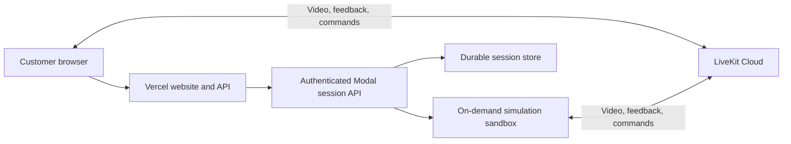

# Try Teleop: assessment and implementation plan

This assessment describes the code on November 9, 2026, including changes that do not yet have a commit.
It does not change the application.
The plan keeps direct robot testing separate from customer simulation trials.
Local trials must use the same customer pages and requests as the Vercel deployment.

## Where the code and services belong

Keep the website in this repository under `web/`.
Add `/try` for customers who want to select a simulation.
Keep `/` and `/workspace` for direct robot testing.

A session is one customer trial.
Use `/workspace?session=<id>` to open the workspace for that session.
Reuse the existing workspace, robot discovery, video, and control code.
Robot discovery finds compatible robots and their controls.

Deploy `web/` on Vercel.
An API is an interface through which programs exchange requests.
Authentication proves that the caller has permission.
Vercel calls an authenticated session API on Modal.
A worker is a program that runs one simulation.
Modal owns the session records, LiveKit rooms, and simulation workers.

Keep the worker and simulation setup in `robo-sims`.
This submodule links this repository to a separate repository.
Extend `sims/demo` for the first release.
Reuse the session rules from the local supervisor, which manages workers.
Replace its local storage and process control for the hosted service.

Keep the local supervisor and native/Docker execution for development.
Native execution runs a worker directly on the development computer.
The hosted service does not need a separate computer that continuously runs the supervisor.
No additional repository is needed.

## How the hosted trial works

Credentials prove identity and grant access.
A sandbox is an isolated environment for one worker.
A durable store keeps session records after a service restarts.
LiveKit carries video, robot feedback, and control commands.
Feedback reports the state of the simulated robot.



The hosted trial follows this sequence:

1. The customer opens `/try` on Vercel and selects a simulation.
2. The browser sends a launch request to `/api/demo/sessions` on Vercel.
3. Vercel makes sure that the request is valid.
4. Vercel forwards the visitor identity and request ID to the authenticated Modal API.
5. Modal reserves a session and space within the limit on active simulations.
6. Modal reserves a generated room name for the session.
7. Modal passes that room name and its access token to the simulation sandbox.
8. The launch request returns a session ID before the simulation becomes ready.
9. The browser repeatedly requests session status through Vercel.
10. The worker reports readiness after it produces initial video and feedback.
11. The worker records a fixed end time, which defaults to 60 seconds after readiness.
12. The browser receives credentials for that room and opens the existing workspace.
13. The browser and worker exchange video, feedback, and commands through LiveKit.
14. At the end time, the worker disables control, disconnects, and exits.
15. Modal removes the room and any remaining compute resources.

Modal credentials stay on the server.
Video and control traffic do not pass through Vercel or the Modal API.

Vercel handles short requests.
Modal owns the simulation lifetime independently of those requests.
A hard timeout stops a sandbox after a maximum duration.
Periodic cleanup finds abandoned runs and retries failed cleanup.
These limits continue to apply after the customer closes the page.

Opening `/` or `/workspace` does not contact Modal or launch a simulation.
Direct robot testing remains available in the private or local deployment.
It does not require the trial service.

Modal supports [HTTP endpoints](https://modal.com/docs/guide/webhooks), [background jobs](https://modal.com/docs/guide/job-queue), and [sandboxes](https://modal.com/docs/guide/sandboxes).
During implementation, make sure that the code follows the current official Modal documentation.
Before building hosted session creation, select the durable store.
Select a reservation method that prevents simultaneous requests from exceeding capacity.

## Give each trial its own robot room

Each launch creates one session with its own LiveKit room.
The browser joins only the room for that session.
It cannot discover or control robots from another trial through those credentials.
If a visitor starts another trial, that trial gets a separate room.
This plan does not combine separate trials into one visitor room.

Use the room name format `<scientist>-<hash8>`, such as `curie-a7`.
Reuse the scientist names already used for participant names.
An 8-bit hash is a value from 0 to 255.
Represent it with exactly two lowercase hexadecimal characters, including a leading zero when needed.
Keep the full session ID separate from this short room name.

Generate and reserve the room name in the session service before starting the worker.
Derive the suffix from the session ID and a retry value with a hash such as SHA-256.
Use the first byte of the result for the suffix.
Store the selected name in the session record.
Retries, refreshes, and reconnections must reuse that stored name.

The short suffix cannot guarantee a unique room name.
Reserve names with a unique constraint in the session store within each LiveKit project.
A unique constraint prevents two records from reserving the same name.
If a name already exists, select another scientist name or retry value.
Use a bounded retry limit and report failure if no name becomes available.
Never attach a new trial to an existing room after a collision.

Keep development and customer trials in separate LiveKit projects or coordinate room reservations across their services.
Do not reuse a name while its previous room or access tokens remain valid.
Keep the name reservation until cleanup and token expiry permit reuse.
If an unexpected room already uses a reserved name, reject that name before launching a worker.

Pass the room through the complete launch path with these changes:

- Include `room_name` in the stored session and worker launch configuration.
- Create the LiveKit room with the stored name.
- Pass `LIVEKIT_ROOM_NAME` explicitly to native, Docker, and Modal workers.
- Issue the worker token for that exact room.
- Make sure that the worker room configuration matches the room in its token.
- Return `room_name` with the browser credentials for the owned session.
- Issue browser tokens for that exact room only.
- Reject client attempts to select an arbitrary room or replace the stored room name.
- Use the stored name for logs, stop requests, and room cleanup.

The token determines which room the worker and browser can join.
The explicit room name supports consistent launch configuration and debugging.
The room name and short hash do not grant access.
Ownership rules and signed tokens enforce access.
Keep LiveKit API secrets in the session service.

Apply these rules in both `--modal` and default local modes.
Preserve the configured room for direct robot testing.
Only managed trials use the generated room names.

## Run the same workflow locally

Select the execution mode when starting the website.
Use the same `web/` application, `/try` page, and managed workspace in both modes.
The browser always calls the local website through `/api/demo/*`.
Only the server configuration changes where the website sends those requests.

Extend `scripts/demo-local.py` with these proposed commands from the repository root:

```sh
python3 scripts/demo-local.py --modal
python3 scripts/demo-local.py
```

Default to local execution without a flag. Use `--modal` to opt in to Modal.
Keep `--no-modal` as a compatibility alias, and reject conflicting flags.
Apply the choice to that website process until it stops.
Do not expose the choice through browser controls or request parameters.
If the selected service fails, report the failure instead of switching modes.

| Mode | Website | Session service | Simulation | LiveKit |
| --- | --- | --- | --- | --- |
| Local `--modal` | Local Next.js application | Deployed development API on Modal | Modal sandbox | Reachable LiveKit Cloud project |
| Local (default) | Same local Next.js application | Local supervisor | Local worker process | Local LiveKit server |
| Hosted | Same application on Vercel | Deployed Modal API | Modal sandbox | Reachable LiveKit Cloud project |

In `--modal` mode, the local website calls the deployed development API on Modal.
This follows the hosted request path without deploying each website change to Vercel.
The worker never needs to call the local website.
Use a development deployment and session records separate from customer trials.
Modal cannot reach a LiveKit server at the laptop address `127.0.0.1`.

In the default local mode, the launcher starts the website, local supervisor, and local LiveKit server.
The supervisor starts real simulation workers on the development computer.
This mode does not require Modal credentials or a Modal connection.
Model assets and Python dependencies must already be installed locally.
Preserve Docker execution as an optional local provider.

The two services must implement the same API behavior.
Use the same simulation IDs, request formats, status values, credential format, ownership rules, and retry behavior.
Use the same worker code, readiness rule, duration configuration, and FPS configuration.
Keep generated fixture data separate from these real simulation trials.
Local rendering speed can differ from Modal rendering speed.
Local trials do not replace tests of Vercel hosting or Modal execution.

The launcher must prepare the selected mode before it starts Next.js.
Use the existing `SIM_SUPERVISOR_URL` and `SIM_SUPERVISOR_KEY` connection configuration or document replacement names during implementation.
The selected URL points to either the local supervisor or the Modal API.
Keep credentials on the server and keep trial configuration separate from direct robot configuration.
Do not rewrite either existing `.env.local` file.

The launcher must provide these debugging controls:

- Make sure that dependencies and credentials exist for the selected mode only.
- Wait for the selected session service before opening the website.
- Preserve `SIM_WEB_PORT` for the local website port.
- Print the selected mode, service address, website URL, and log location without credentials.
- Give local and Modal development runs separate records and logs.
- Include the session ID in website, service, and worker logs.
- Stop services that the launcher starts when the developer presses Ctrl-C.
- Request cleanup of remote trials that this launcher started when it exits normally.
- Preserve worker deadlines and remote cleanup after an abrupt launcher failure.
- Leave unrelated services and trials running.

Opening the direct dashboard must remain independent of the selected trial mode.
Starting the website or opening `/try` must not start a simulation.
Only a customer launch request starts one.

## What exists today

The registry at `robo-sims/sims/registry.py` includes the four requested simulations:

- `trossen-wxai`
- `trossen-wxai-whack`
- `trossen-workbench`
- `trossen-workbench-whack`

All four support managed sessions, which the service starts and stops.
The local service also requires their model assets.
Assets are the files that describe the simulation models.

A provider starts and manages workers in one environment.
A visitor cookie stores a visitor ID in the browser.
Ownership rules limit access to the visitor who started a session.
Request IDs prevent duplicate launches when the same request reaches the service twice.
The browser must reuse the same request ID for this protection to work.

FPS means frames per second.

| Area | Existing code | Remaining work |
| --- | --- | --- |
| Simulation selection | `web/src/components/demo/simulations.tsx` implements selection and launch. | No current page displays this component. |
| Session requests | `web/src/app/api/demo/[...path]/route.ts` forwards requests to `sims/demo/supervisor.py`. | Connect the hosted version to Modal. |
| Separate trials | The supervisor creates a separate room, robot identity, run directory, and worker. | Preserve this separation on Modal. |
| Ownership and retries | The service uses request IDs, visitor cookies, a server key, and ownership rules. | Reuse the request ID when the browser retries a launch. |
| Request protection | The website requires changes to come from its own origin. | Preserve this protection in the hosted version. |
| Preview and control | `useDemoSession` connects the preview and workspace to the selected simulation. | Restore the page that exposes the workflow. |
| Countdown and shutdown | The worker starts its deadline after initial video and feedback. | Replace the fixed 60-second duration with configuration. |
| Video rate | The worker accepts `--fps`. | Pass the configured rate from the service. Browser launches currently use 12 FPS. |
| Local execution | Native and Docker providers work with `scripts/demo-local.py`. | Preserve local development. |
| Modal execution | `scripts/modal-smoke.py` starts one workbench-whack sandbox. | Connect Modal execution to the session API. |
| Direct robot testing | `/` and `/workspace` connect without a simulation session ID. | Preserve this independent workflow. |
| Public deployment | The complete hosted workflow is missing. | Deploy and test Vercel, Modal, and LiveKit together. |

Managed sessions share the scene registry, gateway, and physics code with the command-line launcher.
The gateway connects the simulation to LiveKit.
Managed sessions do not literally execute `python -m sims run`.
They currently use classic rendering, smaller video dimensions, and 12 FPS.
The command-line launcher defaults to Filament and larger dimensions.

The documentation and browser tests describe an older home page.
`docs/modal.md` places simulation selection at `/`, but `/` currently displays `WorkspaceApp`.
Links from managed sessions also return to `/`.
The optional browser test expects the missing selection page.
Its partial-name selectors match both base and whack variants.

## Implementation plan

### 1. Restore simulation selection

Keep direct robot testing available throughout this work.
The customer trial starts at `/try`.
The existing dashboard URLs keep their current purpose.

Make these website changes:

- Add `/try` with the existing `Simulations` component.
- Add a link from `/try` to the direct workspace.
- Add a link from the dashboard to `/try`.
- Preserve `/`, `/workspace`, `/robot`, `/rover`, and fixture mode, which uses generated test data.
- Open the managed workspace automatically when the simulation becomes ready.
- Keep preview optional.
- Return links from managed sessions to `/try`.
- Show different messages for startup failure and normal completion.
- Offer another launch after the session ends.
- Limit the customer selection page to the four supported simulations.
- Hide unsupported simulations or label them as unavailable.
- Update the documentation and browser tests to use `/try` and exact simulation IDs.

For acceptance, make sure that direct discovery works without the trial service.
With the service available, make sure that customers can select and control each requested simulation.
Opening the direct dashboard must never launch a simulation.

### 2. Configure duration and video rate

A token is a signed credential with access limits.
The service selects the launch configuration.
Customers cannot select arbitrary compute configuration.
A change to the configuration affects new sessions only.

Make these changes to the service and worker:

- Add defaults such as `SIM_SESSION_DURATION_SECONDS=60` and `SIM_SESSION_FPS=30`.
- Make sure that configured values are finite, positive, and within explicit limits.
- Store the selected duration and FPS in each session record before launch.
- Pass those values through native/Docker providers and the Modal launch path to the worker.
- Derive every deadline and timeout from the stored configuration.
- Derive token lifetimes from that configuration.
- Support longer sessions without relying on the current 120-second robot token.
- Expose the duration to the website for accurate text.
- Calculate the countdown from `expires_at`.
- Remove fixed 60-second completion messages.
- Start the timer after initial video and feedback become ready.
- Keep the end time unchanged after preview, refresh, or reconnection.
- Share simulation setup code with the command-line launcher where practical.
- Document deliberate differences in rendering.

The worker needs an elapsed-time clock that does not change with the computer clock.
The browser needs an end time based on the computer clock for its countdown.
Time spent connecting the browser consumes trial time, as it does today.

For acceptance, test the default 60-second duration and a shorter custom duration through the complete workflow.
Make sure that refresh preserves the end time.
Make sure that worker launch and discovery report the configured FPS.
Measure delivered FPS separately from requested FPS.

### 3. Add both local launch modes

Extend the existing `scripts/demo-local.py` launcher.
Keep the customer pages and browser requests identical in both modes.
Share session rules between the local supervisor and Modal API.

Complete these launcher and service tasks:

- Default to local execution and add the `--modal` opt-in flag.
- Select the service URL and credentials before starting Next.js.
- Start the local supervisor and LiveKit only in the default local mode.
- Use the deployed development API and reachable LiveKit Cloud in `--modal` mode.
- Reuse duration, FPS, ownership, request IDs, and session transitions across both services.
- Share scientist room naming, collision handling, and worker room configuration across both services.
- Keep storage and worker control specific to each environment.
- Preserve local SQLite for the single local supervisor.
- Add startup diagnostics and shutdown behavior from the local workflow section.
- Document prerequisites and exact commands for each mode.

For acceptance, run the same browser tests against each mode.
Make sure that default local execution works without Modal credentials or API access.
Make sure that `--modal` works without a local LiveKit server or local simulation dependencies.
Make sure that startup leaves all simulations stopped until the customer selects one.

### 4. Build the Modal session API

Modal hosts both the session API and simulation compute.
The existing sandbox smoke test provides a starting point.
A smoke test tests the main workflow.
Use the current official Modal documentation during implementation.

A container packages a program and its dependencies.
Build the session API with these tasks:

- Add authenticated endpoints for simulation selection, launch, status, stop, and credentials.
- Preserve compatibility with the existing `/api/demo/*` request format.
- Enforce visitor ownership in both the Vercel API and Modal API.
- Reuse the session rules from the local supervisor.
- Store session state, owner, request ID, launch configuration, room, sandbox ID, and timestamps in durable storage.
- Prevent duplicate launches and capacity violations across simultaneous requests.
- Run launch and cleanup work independently of HTTP request handlers.
- Return the `starting` session promptly.
- Expose progress and failures through status requests.

Do not rely on memory within one container, local SQLite, or file locks for hosted session coordination.
Vercel must not depend on work that continues after it returns a response.

Add remote worker control with these tasks:

- Support start, readiness reports, orderly stop, running status, forced stop, and logs.
- Replace hosted dependence on local `event.json` and `control.json` files.
- Authenticate messages between workers and the session API.
- Store each sandbox ID as soon as Modal creates it.
- Recover sandbox control after a request handler or background task fails.
- Make repeated readiness reports safe for the same run.
- Reject late reports that attempt to revive stopped sessions.
- Preserve the same session behavior for native and Docker execution.

Currently, the provider interface covers only start, status, and stop.
The local supervisor reads `event.json` and writes `control.json` directly.
The hosted version needs remote communication for those events and commands.

An image packages the worker code and required files.
Prepare simulation execution with these tasks:

- Build a versioned image with all four scenes and their assets before customer requests arrive.
- Determine availability from that deployed image.
- Preserve a separate LiveKit room for each trial.
- Give each worker a token that grants access to its room only.
- Keep the LiveKit API secret in the Modal service.
- Set separate limits for startup, active simulation time, and cleanup.
- Calculate the sandbox timeout from those limits.
- Handle stop requests during startup and launches that finish after cancellation.
- Run periodic cleanup independently of website requests.
- Retry cleanup after failures and release capacity reservations.
- Keep the worker deadline active during API or storage outages.
- Prevent slow status requests from delaying other session deadlines.

The existing smoke test uses a configured shared room.
The hosted session implementation must use separate rooms instead.

For acceptance, launch all four scenes from the browser against reachable LiveKit.
Receive video and feedback, then move a joint.
Make sure that stop, expiry, page closure, and service failure lead to worker and room cleanup.

### 5. Deploy the customer experience

Use Vercel for the existing Next.js application.
Use Modal for the session API, background tasks, and simulation image.
Use LiveKit Cloud that both the browser and workers can reach.

Prepare the deployment with these tasks:

- Configure Vercel with the Modal API URL and server credentials.
- Keep the LiveKit API secret in the Modal service.
- Send the LiveKit URL, generated room name, and room-limited worker token to each sandbox.
- Configure durable storage and periodic cleanup on Modal.
- Support simultaneous API containers and container replacement.
- Enable trial APIs on the public deployment.
- Disable `/api/credentials` on the public deployment.
- Preserve direct-room credentials for private and local development.
- Separate the direct robot configuration from the trial service configuration.
- Document how `.env.local` and process values affect each deployment.

`/api/credentials` currently grants operator access to a configured room without authentication.
Do not expose the development robot room publicly.
The same application can serve separate public and private deployments.
The credential route prioritizes `.env.local` over process values.
The local demo launcher supplies another configuration profile.

Add service limits and operational support with these tasks:

- Limit the total number of active simulations.
- Limit each visitor to one active trial.
- Limit launch requests and compute spending.
- Show clear messages when capacity is full.
- Preserve request IDs when the browser retries a launch.
- Record session events and startup or cleanup failures.
- Provide service health information.
- Limit retention of session records and logs.
- Document environment variables, image versions, deployment order, and rollback.
- Test the complete Vercel deployment before sharing its URL with customers.

A visitor cookie alone does not limit abuse because visitors can clear it.
A queue for waiting customers is optional.
The hosted service must work without a continuously running local supervisor.

For acceptance, make sure that simultaneous launches respect capacity.
Make sure that visitors cannot obtain credentials for another visitor's session.
Make sure that public requests cannot obtain direct-room tokens.
Make sure that failed launches release compute resources and room reservations.

### 6. Test and release

Keep unit tests for isolated session rules.
Add browser tests for the complete customer workflow.
Run remote tests against the deployed image and LiveKit.

Complete these release tasks:

- Test configuration limits, ownership, duplicate requests, capacity, deadlines, and recovery.
- Test direct robot selection with the trial service disabled.
- Make sure that the direct dashboard requests credentials and finds a compatible robot.
- Test `/try` with each of the four exact simulation IDs in both local modes.
- Test video, control, expiry, custom duration, reload, and access from another visitor.
- Test startup failure, full capacity, and early stop.
- Test separate rooms for successive trials from one visitor and simultaneous trials from different visitors.
- Test two-character hash formatting, collisions, duplicate launch requests, and stable names after refresh.
- Make sure that worker configuration and browser credentials use the stored room name.
- Make sure that trial tokens cannot join another trial room or the direct robot room.
- Make sure that cleanup deletes only the room for its session.
- Test rejection of conflicting launcher flags and missing configuration.
- Test normal launcher shutdown and abrupt launcher failure in both modes.
- Make sure that shutdown affects only services and sessions owned by that launcher.
- Make sure that direct robot testing works in both modes when the trial service fails.
- Run the hosted tests against Vercel, Modal, and LiveKit.
- Add a scheduled or manually started smoke test if the infrastructure supports it.
- Document direct testing, local trials, and hosted trials separately.
- Coordinate `robo-sims` changes in its separate repository.
- Update this repository to use the resulting `robo-sims` commit.

## Tests completed for this assessment

In `web`, `pnpm test` passed 98 tests across five files.
In `robo-sims`, `.venv/bin/python -m unittest discover -s tests -p test_demo.py -v` passed four supervisor tests.
Those supervisor tests used a fake provider.

The assessment included reading the optional provider tests, browser tests, and Modal smoke test code.
It did not start native simulations, containers, or paid cloud compute.
It did not rerun browser or remote tests.
The passing unit tests do not prove that the complete customer workflow works.

## Proposed scope

Keep one web application in this repository.
Use `/try` for customer trials and preserve the direct dashboard URLs.
No additional repository is needed.

Default each trial to 60 seconds after readiness.
Let the operator configure the duration.
Target 30 FPS and measure the delivered rate in the hosted tests.

Vercel hosts the website and forwards session requests.
Modal hosts the session API and simulation sandboxes.
Durable records and periodic cleanup support recovery after failures.
Keep the local supervisor and native/Docker execution for development and testing.
Use local execution by default, or opt in to Modal with `--modal` at website startup.
Keep the customer workflow identical across local and hosted websites.
